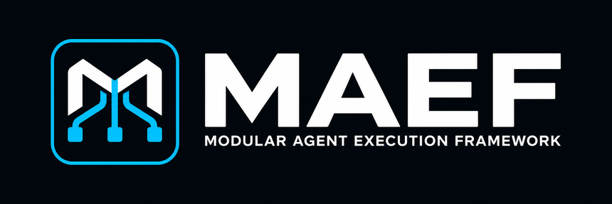

<p align="center">
  
</p>

# MAEF — Modular Agent Execution Framework

**Status: architecture + runnable registry/studio bootstrap (v0.1.0).** Not an operational agent executor yet.

MAEF is a local-first, Git-native framework for defining specialist agents, reviewing their skills and configuration, and eventually dispatching isolated, budget-controlled tasks to local or remote workers. Main clients (Codex, Claude Code, etc.) should only need the small MAEF gateway, not every specialist MCP.

## Included now
- Typed YAML agent definitions and a local Git-friendly registry.
- Read-only FastAPI endpoints to inspect agent definitions and context files.
- Task **preview** endpoint showing effective bounded budgets and selected runtime profile.
- React Studio for inspecting agents, skills, model/sandbox profiles, outputs and task previews.
- One example agent definition and API tests.
- Architecture, contracts, ADRs, security considerations and phased roadmap.

**Opt-in execution:** with `MAEF_EXECUTION_ENABLED=1`, `POST /api/v1/runs` admits a budget-reserved, tool-less Bedrock Converse call (needs the `bedrock` extra, a gitignored model profile and a clean git tree or `MAEF_ALLOW_DIRTY=1`). It is off by default and returns 501. Runs and append-only events live in a SQLite ledger (`MAEF_DB`, default `runs/maef.db`); `MAEF_ACCOUNT_LIMIT_TOKENS` (default 5,000,000) caps total token use.

**Not implemented:** sandbox execution, tools, MCP client/server, remote workers, actual spend enforcement, authentication, publishing, Git commit automation. Studio clearly labels previews as non-executions.

## Requirements
- Python >=3.11
- Node.js >=20 and npm

## Start the API

```bash
python -m venv .venv
source .venv/bin/activate
pip install -e '.[dev]'
make api
```

API: http://127.0.0.1:8000/docs

## Start the Studio (second terminal)

```bash
cd apps/studio
npm install
npm run dev
```

Studio: http://127.0.0.1:5173

## Validate

```bash
pytest -q
cd apps/studio && npm run build
```

## Monorepo layout

```text
apps/api/              FastAPI registry and task preview control plane
apps/studio/           React TypeScript management UI
agents/                Git-managed reusable specialist definitions
packages/contracts/    Versioned contracts and schema documentation
docs/                  Product brief, architecture, ADRs, roadmap, security
infra/                 Future worker and deployment assets
examples/              Sample delegation payloads
tests/                 API contract/behaviour tests
```

## Design principles
1. Distinguish agent definition, harness, sandbox, worker and model endpoint.
2. Use versioned contracts and immutable definition revisions per run.
3. Keep execution tools, secrets and MCPs away from the parent coding agent.
4. Local-first; remote workers speak a stable authenticated protocol.
5. Explicit budgets; all cost calculations in precise units, with admission reservations.
6. Fail closed on missing policy, unknown cost model or unavailable isolation.
7. Human review for privileged actions and promotion of produced changes.

See [Architecture](docs/ARCHITECTURE.md) and [Roadmap](docs/ROADMAP.md).
