# Architecture

This page explains how MAEF is built, in plain terms. Setup details are in [RUNNING.md](RUNNING.md); exact formats
are in [CONTRACTS.md](../packages/contracts/CONTRACTS.md).

The diagrams in [`diagrams/design/`](diagrams/design/) were drawn with the diagram-design skill (open the `.html`
files in a browser for the full-quality version; the `.svg` files are exports).

## The big picture

MAEF has two halves that never run in the same process:

- **The API (control plane)** decides *what* may run. It checks requests, pins the exact agent version, reserves
  tokens, keeps the log, hands out work and stores results. It never runs model calls or agent tools.
- **The worker (execution plane)** does the running. It asks the API for work, calls the model, runs tools inside
  containers, and reports every step back. It never touches the database directly; it only talks to the API over
  HTTP with its own credential.

This split means the part that holds the records and the keys is never the part that runs untrusted tools, and it
lets workers live on other machines later without changing anything else.

Around them:

| Part | Job | Options |
|---|---|---|
| Ledger | the only place run state lives: runs, append-only events, token reservations, keys (hashed), audit log | SQLite file (default) or Postgres |
| Artifact store | result files, named by their sha256 fingerprint, checked on every read | local folder (default) or S3-compatible |
| Agent definitions | `agents/<id>/` in Git | read from the Git object store at a pinned revision |
| Model endpoints | where the worker sends model calls | Ollama, LM Studio, OpenAI, Anthropic, Bedrock; Jev and Clef for decisions |
| Clients | ways to start and watch runs | `maef` CLI, terminal UI, MCP gateway for Claude Code / Codex, HTTP |

## What happens during a run

1. **Request.** A client sends an agent id, an instruction and an optional tighter budget.
2. **Admission.** The API resolves the agent at its Git revision and records digests of every file the run will use
   (instructions, model profile, sandbox profile, MCP manifests). It reserves the worst-case token cost. If anything is
   missing or the account has too few tokens left, the run is refused before it starts.
3. **Lease.** A worker asks for work and gets a *lease*: the run id, the pinned definition and the budget. No secrets
   travel with it; the worker reads model keys from its own environment.
4. **Execution.** The worker checks the digests, starts the sandbox and MCP containers, and loops: call the model,
   run the requested tools, record usage, send events. Each heartbeat reply can say "cancel".
5. **Finish.** The worker uploads `output.md` (and any other outputs), reports the result, and removes its
   containers. The API charges the tokens actually used and returns the rest of the reservation.
6. **Watch.** Clients follow the events live (server-sent events, resumable) and download the result.

### Run states

A run only moves forward. `succeeded`, `failed` and `cancelled` are final. If a worker stops sending heartbeats, its
lease expires and the run fails as `worker_lost`. Leases are *fenced*: a worker that comes back late cannot write to a
run that has moved on, and repeated reports (retries) are recognised and ignored.

## Budgets

Budgets are in tokens only, with limits on turns and time as well. Before a run starts, the API reserves the most it
could possibly use: the agent's `max_tokens`, or less if the turn and output limits make a smaller worst case
possible. During the run, the worker's budget guard checks before every model call and stops the run when a limit
would be crossed. At the end, the run is charged the larger of what the model reported and what the worker recorded,
so under-reporting cannot make a run cheaper. An account-wide cap (`MAEF_ACCOUNT_LIMIT_TOKENS`) covers all runs
together. Details: [BUDGETS_OBSERVABILITY.md](BUDGETS_OBSERVABILITY.md).

## Isolation and the network

The agent loop itself runs in the worker process. What the model asks to *do* runs in containers:

- **Sandbox** (for `run_command`): one container per run, read-only filesystem, every Linux capability dropped, no
  privilege escalation, no network, no host folders, memory/CPU/process limits, an unprivileged user, and a small
  temporary `/workspace`. Images must be pinned by digest. Rootless Podman is required by default.
- **MCP tool servers**: each in its own container. With `network: allowlist` the container sits on a private per-run
  network whose only exit is the egress proxy. The proxy allows only the listed hosts and ports, resolves names
  itself, connects only to public addresses it has checked, and never to cloud-metadata addresses or your local
  network.
- **Model calls** go from the worker over HTTPS (or plain HTTP to localhost). The same address checks apply: no
  metadata addresses, private networks only when a profile opts in, no redirects.

Containers are driven through the `podman`/`docker` command line, so the same code runs on Linux, WSL2 and macOS and
there is no Docker socket to protect. Containers are an extra layer of defence, not a hard boundary against hostile
code; see [SECURITY.md](SECURITY.md) for known gaps.

## Inside the code

All backend code is in `apps/api/maef_api/`. A few modules carry most of the weight, each behind a small interface:

| Module | Interface | Hides |
|---|---|---|
| `definitions.py` | `Definitions.resolve(agent_id, revision)` returns a `PinnedDefinition` | reading Git objects, digests, file references |
| `ledger.py` | `Ledger` (admit, claim, append event, settle, audit) | all SQL; `_sql_sqlite.py` and `_sql_postgres.py` are the two dialects |
| `runs.py` | `Runs` (submit, cancel, results) | admission rules, used by HTTP routes and the CLI alike |
| `artifacts.py` | `ArtifactStore` (put, get, exists) | local folder, in-memory (tests) or S3 (`artifacts_s3.py`) |
| `channel.py` | `WorkerChannel` | how a worker talks to the API (HTTP, or in-process for tests) |
| `harness.py`, `guard.py` | the agent loop and `BudgetGuard` | turns, tool dispatch, limits, cancellation |
| `adapters/` | `ModelAdapter`, `DecisionAdapter` | each provider's wire format (OpenAI-compatible, Anthropic, Bedrock, Jev, Clef) |
| `sandbox.py`, `mcp.py`, `egress_proxy.py` | `Sandbox`, MCP client | container flags, networks, the proxy |
| `auth.py` | scopes, tokens, worker credentials | hashing, audit records |

Every interface has at least two implementations (a real one and one used in tests), which is why most of the code can
be tested without containers, model servers or the network.

## Key decisions

- **Git is the source of truth for agents.** Runs record the commit and a digest of the files, so a result can always
  be traced to the exact instructions and settings that produced it. Draft edits happen on their own branch; a human
  merges.
- **Append-only log.** Events cannot be changed or deleted through the application (database triggers reject UPDATE and DELETE), so the
  record of what an agent did is not edited in place. A database administrator can still drop the triggers, and there
  is no hash chain, so it is not tamper-evident. Event payloads hold sizes and token counts; commands and outputs are
  recorded only when the transcript is switched on.
- **Tokens, not money.** Prices change and differ per provider; tokens are what the models report.
- **Fail closed.** Unknown profiles, unpinned images, a rootful runtime when rootless is required, or a missing
  container runtime stop the run instead of running it less safely.
- **Local first.** Every external service is optional and replaceable by a local one.

## What is next

- **Remote workers:** workers on other machines that connect out to the API over HTTPS (no inbound ports), with work
  matched to what each worker can run. The protocol already used by local workers (leases, heartbeats, fenced events,
  idempotent reports) is the one remote workers will use.
- **Web Studio login**, a Postgres connection pool, token expiry and rate limits, decision runs in eval suites.

See [BACKEND_PLAN.md](BACKEND_PLAN.md) and [ROADMAP.md](ROADMAP.md).
